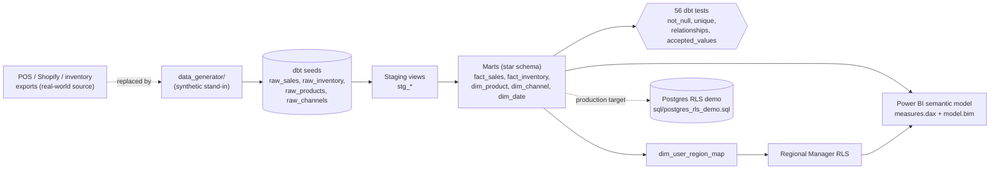

# retail-margin-cockpit

A governed margin and inventory model for retail and DTC teams: a tested dbt star schema, a DAX measure library, and a Power BI semantic model with row-level security, all built on reproducible synthetic POS, Shopify and inventory data.

[](https://github.com/SlateGitOrg/retail-margin-cockpit/actions/workflows/ci.yml)

## Why

At small and mid-sized retailers, "what is our margin?" is a multi-hour exercise. POS exports, Shopify exports and a hand-maintained inventory ledger never join cleanly because product IDs and channel names differ between systems. Finance and Ops end up with different margin numbers, the stockout report is stale by the time it is built, and a regional manager gets a hand-filtered spreadsheet that is one missed filter away from leaking company-wide numbers.

This project replaces that with one small, tested warehouse model, the measures that sit on top of it, and a row-level-security design that is enforced both in Power BI and in Postgres.

## Features

- **Seeded data generator**: two years of internally consistent history (5 channels across 3 regions plus online and wholesale, 32 SKUs in 4 categories, seasonality, promo windows, weekly inventory snapshots, stockouts). The same seed produces the same bytes every run.
- **dbt star schema**: staging views and six marts (`fact_sales`, `fact_inventory`, `dim_product`, `dim_channel`, `dim_date`, `dim_user_region_map`) with 56 generic tests (`not_null`, `unique`, `relationships`, `accepted_values`) and column-level docs.
- **Two warehouse targets, one codebase**: embedded DuckDB by default (zero setup, what CI runs) and Postgres via `--target postgres`.
- **DAX measure library** (`powerbi/measures.dax`): gross margin %, effective discount %, revenue below margin floor, sell-through %, annualized inventory turns, stockout rate, weeks of supply, and YoY / MoM / YTD time intelligence.
- **TMSL semantic model** (`powerbi/model.bim`) with two RLS roles, **Regional Manager** (dynamic, scoped by `dim_user_region_map`) and **HQ Analyst** (unrestricted). Its measures are generated from `measures.dax`, so the two cannot drift.
- **Native Postgres RLS** (`sql/postgres_rls_demo.sql`): the same access boundary enforced for SQL clients that never touch Power BI.

## Architecture



The generator writes raw CSVs into the dbt seeds folder. dbt loads them, builds thin staging views, and materializes the star schema, testing every key on the way. Power BI reads the marts through the semantic model, and the Regional Manager role filters `dim_channel` (and, through its relationships, both fact tables) using the region mapped to the signed-in user.

## Quick start

Requires Python 3.11+. Everything below runs offline, with no Docker and no Postgres.

```bash
python3 -m venv .venv
source .venv/bin/activate        # Windows: .venv\Scripts\activate
pip install -r requirements.txt

# 1. Generate the synthetic dataset (writes the raw CSV seeds)
python -m data_generator.generate --out dbt/retail_margin_cockpit/seeds

# 2. Build the star schema and run all dbt tests on embedded DuckDB
cd dbt/retail_margin_cockpit
dbt build --target duckdb
cd ../..

# 3. Run the full test suite
python -m pytest -q
```

Pointing the same project at a real Postgres warehouse:

```bash
export RMC_PG_HOST=... RMC_PG_USER=... RMC_PG_PASSWORD=... RMC_PG_DATABASE=...
dbt build --target postgres --project-dir dbt/retail_margin_cockpit --profiles-dir dbt/retail_margin_cockpit
PGPASSWORD="$RMC_PG_PASSWORD" psql -h "$RMC_PG_HOST" -U "$RMC_PG_USER" -d "$RMC_PG_DATABASE" -f sql/postgres_rls_demo.sql
```

## Example

Generating the data and building the model:

```text
Wrote synthetic retail dataset to dbt/retail_margin_cockpit/seeds: {'channels': 5, 'products': 32, 'sales': 26572, 'inventory_snapshots': 9530}
...
Finished running 5 seeds, 6 table models, 56 data tests, 5 view models
Done. PASS=72 WARN=0 ERROR=0 SKIP=0 NO-OP=0 REUSED=0 TOTAL=72
```

Margin by category, queried from the built DuckDB file (`RMC_DUCKDB_PATH` controls where it is written):

```sql
select p.category,
       round(sum(gross_revenue))                                         as revenue,
       round(100 * sum(gross_margin_amount) / sum(gross_revenue), 1)     as gross_margin_pct
from marts.fact_sales f
join marts.dim_product p using (product_id)
group by 1 order by 3 desc;
```

| Category | Revenue | Gross margin % |
|---|---:|---:|
| Accessories | $586.0K | 52.3% |
| Apparel | $1.99M | 52.0% |
| Home | $712.6K | 48.4% |
| **Footwear** | **$601.9K** | **42.4%** |

Footwear sits at roughly 42% in every channel (store, online and wholesale alike), against a blended 49.9%. That is easy to miss when channels are reconciled one spreadsheet at a time and obvious once category and channel live in one model. Matching the blended average would add about $45K of gross margin (about 1.2% of revenue) with no change in units sold. Note that this is a property of the synthetic data, which encodes a lower Footwear margin on purpose to give the model something to find.

## How it works

- **Determinism**: the generator is seeded, so the dbt build and its tests are reproducible and CI can assert exact structure.
- **One SQL dialect for two engines**: models avoid engine-specific syntax so the same project and tests run on DuckDB and Postgres. `generate_schema_name` keeps schemas `seed`, `staging` and `marts` consistent across targets.
- **Measures kept in sync**: `scripts/build_model_bim.py` regenerates the measures inside `model.bim` from `measures.dax`; tests fail if they diverge.
- **RLS in two layers**: `Current User Region` and the `dim_channel` table permission implement dynamic RLS in Power BI (a mapped region of `ALL` removes the filter); `sql/postgres_rls_demo.sql` expresses the same rule as native Postgres policies.
- **No `.pbix`**: Power BI Desktop is Windows-only, cannot run in CI, and a binary file does not diff in git. The DAX and TMSL are checked in as text and tested instead; `model.bim` opens in Tabular Editor or as the source for a Model.bim-based Power BI project. Report pages and the RLS test-as-user steps are documented in [powerbi/README.md](powerbi/README.md).

## Testing

```bash
python -m pytest -q
```

This is exactly what CI runs after `ruff check .` and a `dbt build`. The suite covers generator determinism, a real `dbt build --target duckdb` (seeds, views, all six marts, 56 generic tests), SQL sanity checks against the resulting DuckDB file, and consistency between `measures.dax` and `model.bim`. Current result: 60 passed, 1 skipped. The skipped test, `tests/test_postgres_rls.py`, is an opt-in integration test that needs a seeded Postgres and runs only when `RMC_TEST_PG_DSN` is set.

## Project layout

```text
data_generator/    Seeded synthetic retail dataset generator
dbt/               dbt project: seeds, staging views, star-schema marts, tests, docs
powerbi/           measures.dax, model.bim (TMSL), report and RLS documentation
scripts/           build_model_bim.py, syncs model.bim measures from measures.dax
sql/               Postgres row-level-security demo
tests/             pytest suite: generator, dbt build and test, DAX/model checks, RLS (opt-in)
```

## Limitations

- The data is synthetic; the insight above reflects how it was generated, not a real retailer.
- The Power BI report itself is documented, not shipped; only the semantic model and measures are checked in.
- Postgres RLS is covered by an opt-in test and is not exercised in CI.

## License

MIT — see [LICENSE](LICENSE).
